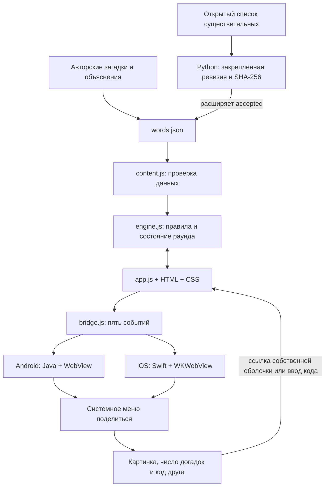

# Архитектура

Версия приложения 1.3.1. Основной продукт — статическая веб-игра. Собственные оболочки Android и iOS содержат ту же игру и добавляют системный шаринг и обработку приглашений. Они не заменяют неизменённую официальную песочницу на защите.

## Два списка слов

В `game/data/words.json` находятся:

- `words`: 96 авторских карточек, по 24 на каждую длину 4–7. Поля: стабильный `id`, ответ `word`, тема `theme`, загадка `riddle`, объяснение `meaning`, вопрос или наблюдение `fact`.
- `accepted`: 16 884 допустимые догадки. Это более широкий список, из которого не выбираются ответы и анимированные примеры.

`scripts/expand_dictionary.py` запускается при разработке. Он скачивает исходный список с закреплённой ревизии, проверяет SHA-256, отбирает существительные из 4–7 русских букв, исключает очевидные грубые слова, добавляет варианты Е для Ё и объединяет результат с прежним `accepted`. Авторские карточки не генерируются и не переписываются. Полный возрастной аудит массового списка не проводился. Источник и MIT-лицензия включены в пакеты.

Во время игры Python и интернет-словарь не нужны. `content.js` загружает локальный JSON, проверяет поля и строит `Set` допустимых догадок. При повреждении или задержке загрузки есть небольшой автономный запасной набор. `engine.js` проверяет ввод по Set и сравнивает буквы с выбранным ответом, учитывая повторы.

## Общая игра и две оболочки

- `engine.js` не знает DOM, iOS и Android. Состояние раунда находится в памяти: ввод, курсор, история, найденные буквы, подсказки, результат. Догадки не ограничены; состояния — игра, победа, ответ открыт.
- `app.js` управляет экранами, вводом, короткими примерами, звуками, canvas-карточкой результата и приглашениями. `styles.css` адаптирует компоновку к видимой области. Плавный градиент — CSS, без GIF и дополнительных файлов, с reduced motion и остановкой в фоне.
- Android открывает встроенные файлы через `WebViewClient` на внутреннем origin `https://game.bukva.invalid`. Сетевые соединения запрещены. HTML/CSS/ES modules/JSON совпадают с каноническим `game/`.
- iOS открывает локальный `WWW` через публичный `WKWebView.loadFileURL`. Во время сборки `ios/prepare_web.py` объединяет фиксированный набор модулей в замкнутый классический скрипт и встраивает JSON. Это устраняет ограничения локальных ES modules и fetch; правила и контент остаются теми же. Лицензия словаря копируется в WWW отдельно.
- Системное меню «Поделиться» реализовано через Android Intent и iOS UIActivityViewController. Игра отправляет только существующий `SHARING_EVENT` с текстом и PNG data URL. Остальные события: CLOSE, FINISH, COMPLETED, VIBRATION. Нет новых событий официального моста.

## То же слово для друга без бэкенда

У карточки есть постоянный `id`. Из него детерминированно получается непрозрачный код формата `BB1-6520ECE2`. Код не содержит ответ, число попыток или персональные данные. Он выбирает карточку, а не восстанавливает чужую сессию. Порядок JSON и добавление карточек на него не влияют. Удалять или менять смысл опубликованного id нельзя. Возможные коллизии кодов проверяются при загрузке контента.

В шаринге передаются картинка результата, число догадок и код. Ссылка собственных приложений: `bukvazabukvoy://challenge/BB1-6520ECE2`. Android Intent filter и iOS URL Types принимают этот адрес, строго проверяют схему, host и код и передают в игру только `#challenge=BB1-6520ECE2`. Произвольный URL или код JavaScript не исполняется. На холодном старте открывается карточка друга. Если уже идёт раунд, его замена требует подтверждения. Ввод неизвестного кода показывает объяснение и сохраняет текущий раунд.

На главном экране есть «Слово друга»: можно вставить код или ссылку вручную, если мессенджер не сделал custom scheme кликабельным. Внешний HTTPS-сервис и база данных для этого не нужны. Отправка сообщения выполняется только явной кнопкой через системное меню.

Непрозрачный код — не криптографическая защита: ответ уже есть в локальном словаре. Для защиты от обычного спойлера этого достаточно; от изучения приложения — нет. Приглашения не истекают, не записывают прогресс и не доказывают результат отправителя.

## Граница интеграции СберKids

В локальной копии официальной Android-песочницы `CONTEXT.md` описан односторонний мост «страница → приложение», README и test-page демонстрируют передачу текста и картинки. Примеров документированного launch URI СберKids и передачи параметра игры в этих файлах и исходных PDF не обнаружено. Схема `bukvazabukvoy` принадлежит нашим автономным приложениям, она не выдаётся за схему СберKids.

Код работает в самой веб-игре, в том числе через «Слово друга» в официальном контейнере. Автоматический переход именно в установленный СберKids требует зарегистрированной платформой ссылки и сохранения кода при открытии WebView. После предоставления такого контракта меняется формирование ссылки и адаптер контейнера; механизм выбора карточки остаётся прежним. Работоспособность собственного custom scheme не подтверждает наличие такой интеграции у Сбера.

## Состояние и поставка

Нет сервера, базы данных, аккаунта и постоянных сохранений. После закрытия сеанс сбрасывается. Внешний мир из игры не запрашивается. Сдаваемый `game/` — меньше 5 МБ; исходники, тесты, документы и нативные SDK в этот бюджет не входят.

Android APK устанавливается напрямую. iOS Simulator ZIP предназначен для Mac; device-unsigned ZIP подтверждает компиляцию arm64, но для установки на iPhone нужна подпись в Xcode или отдельная настройка TestFlight. Релиз GitHub сам по себе не публикует приложение в App Store или СберKids.
